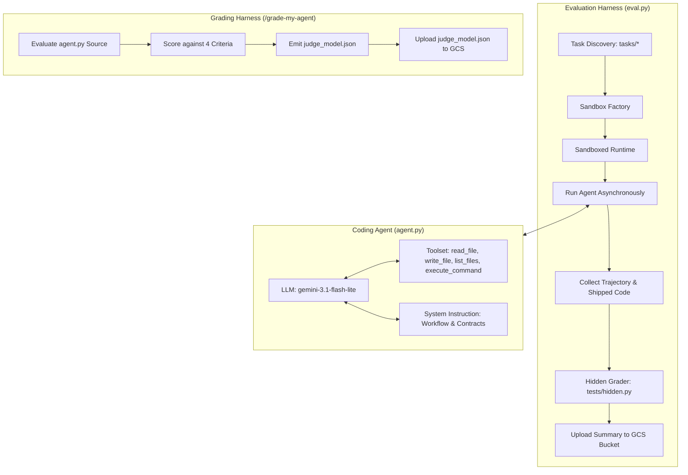

# Hill-Climbing a Coding Agent: Lab Manual, Architecture, Runbook & Playbook

---

## 1. Architectural Design

### 1.1 System Architecture Overview

The system implements an automated **Evaluation and Hill-Climbing Loop** for an AI Coding Agent built on Google GenAI and the Agent Development Kit (ADK).



### 1.2 Component Breakdown

1. **Agent Engine (`agent.py`)**:
   - **Model**: `gemini-3.1-flash-lite` configured with `temperature=0.0` and `thinking_level=LOW`.
   - **Tool Engine**:
     - `read_file(path)`: Safely read file contents within sandbox boundaries.
     - `write_file(path, contents)`: Create or update source files inside sandbox.
     - `list_files(directory)`: Recursive directory walker enabling codebase exploration.
     - `execute_command(command)`: Subprocess shell executor running tests, scripts, and commands inside the sandbox with stdout/stderr capture and return codes.
   - **System Instruction**: Enforces root-cause exploration, import tracing, test-driven validation, and edge-case handling (sequence directions, half-up rounding, empty inputs, exit codes).

2. **Evaluation Harness (`eval.py`)**:
   - Discovers test tasks in `tasks/`.
   - Isolates executions inside ephemeral per-task sandboxes.
   - Harvests event trajectories into ADK-compliant JSON artifacts (`trajectory.evalset.json`, `tool_uses.json`, `repro.sh`).
   - Executes hidden unit/integration tests (`tests/hidden.py`) to grade solutions.
   - Summarizes and uploads results to Google Cloud Storage (`gs://<PROJECT_ID>-l400-apex/summary.json`).

3. **LLM-as-Judge Grader (`grade-my-agent`)**:
   - Evaluates `agent.py` across:
     - Execution Tool capability (40 points)
     - Verification Discipline (20 points)
     - Root-Cause Direction (20 points)
     - Edge-Case & Format Rigor (20 points)
   - Emits `judge_model.json` and syncs with GCS.

---

## 2. Step-by-Step Lab Manual

### Step 1: Initialize Environment and Virtualenv
```bash
python3 -m venv --system-site-packages .venv
source .venv/bin/activate
```

### Step 2: Establish the Baseline
Run the baseline evaluation across all five tasks:
```bash
python eval.py
```
*Expected baseline outcome*: 0/5 solved due to lack of execution tools and missing verification capabilities.

### Step 3: Investigate Trajectories and Failures
Run reproduction scripts to expose specific failure modes:
```bash
bash runs/<TIMESTAMP>/invoice_report/repro.sh
bash runs/<TIMESTAMP>/reminder_time/repro.sh
```
Key findings:
- `invoice_report`: Failed due to inability to explore upstream files (`load.py`) and lack of execution tools.
- `reminder_time`: Timezone offset stripped in upstream `parsing.py`; agent was trapped in `core.py`.
- `interval_set` / `expense_report`: Crashes on empty inputs when quantizing integer 0.
- `range_list`: Missing support for descending ranges (e.g., `9-7` -> `9 8 7`).

### Step 4: Submit Diagnosis
Submit formal diagnosis of the agent's missing capabilities using the diagnosis skill:
```text
/submit-task-diagnosis ask name: invoice_report
Observed trajectory behavior: In the events, the agent only had read_file and write_file. Notice calls call_929488, call_202614, and call_714832 where it kept creating files (reproduce_issue.py, run_reproduce.py, exec_ls.py) containing subprocess.run in a desperate attempt to inspect the system and test the code.
Capability gap: The agent had no execution tool (execute_bash / command runner). Because it could not run commands, it had to make an unverified edit to src/invoices/report.py and finalize the response without ever running tests.
```

### Step 5: Optimize `agent.py`
1. Equip the agent with `execute_command` and `list_files`.
2. Set temperature to `0.0`.
3. Provide comprehensive system instructions specifying root-cause tracing, test execution before finishing, and edge case coverage.

### Step 6: Validate and Grade
Re-run evaluation harness:
```bash
python eval.py
```
Target pass rate: $\ge 4/5$ tasks passing.

Submit agent for final grading:
```text
/grade-my-agent
```
Target score: $100/100$, verdict `pass`.

---

## 3. Operations Runbook

| Action | Command / Procedure | Notes |
|---|---|---|
| **Activate venv** | `source .venv/bin/activate` | Must be run in each shell session. |
| **Run all evaluations** | `python eval.py` | Runs 5 tasks in parallel with `gemini-3.1-flash-lite`. |
| **Run single task** | `python eval.py --task <task_id>` | Useful for focused iteration. |
| **Inspect latest run** | `ls -1dt runs/*/ \| head -n 1` | Path to latest artifacts. |
| **Reproduce single failure** | `bash runs/<TIMESTAMP>/<task_id>/repro.sh` | Runs hidden test against agent's shipped code. |
| **Check GCS Uploads** | `gcloud storage ls gs://${GOOGLE_CLOUD_PROJECT}-l400-apex/` | Verifies `summary.json` and `judge_model.json`. |

---

## 4. Troubleshooting Playbook

### Incident 1: Agent Fails on Descending Ranges (`range_list`)
- **Symptom**: `range_list` returns empty string or fails when given inputs like `9-7`.
- **Root Cause**: Standard `range(start, end + 1)` yields empty when `start > end`.
- **Resolution**: Ensure system instruction instructs the agent to handle sequence direction and test reversed/descending ranges explicitly.

### Incident 2: Attribute Error on Empty Currency/Decimal Calculations
- **Symptom**: `AttributeError: 'int' object has no attribute 'quantize'`.
- **Root Cause**: `sum()` over an empty collection returns integer `0`, which cannot be quantized by `decimal.Decimal`.
- **Resolution**: Instruct the agent to initialize sums with `Decimal(0)` or convert input values explicitly before quantizing.

### Incident 3: Float vs. Decimal Equality Assertion Failures
- **Symptom**: `assert parse_amount("19.99") == 19.99` fails when `Decimal('19.99') != 19.99`.
- **Root Cause**: Upstream parsing functions expect primitive `float` rather than `Decimal`.
- **Resolution**: Instruct the agent to preserve existing module types and function signatures unless explicitly requested otherwise.
