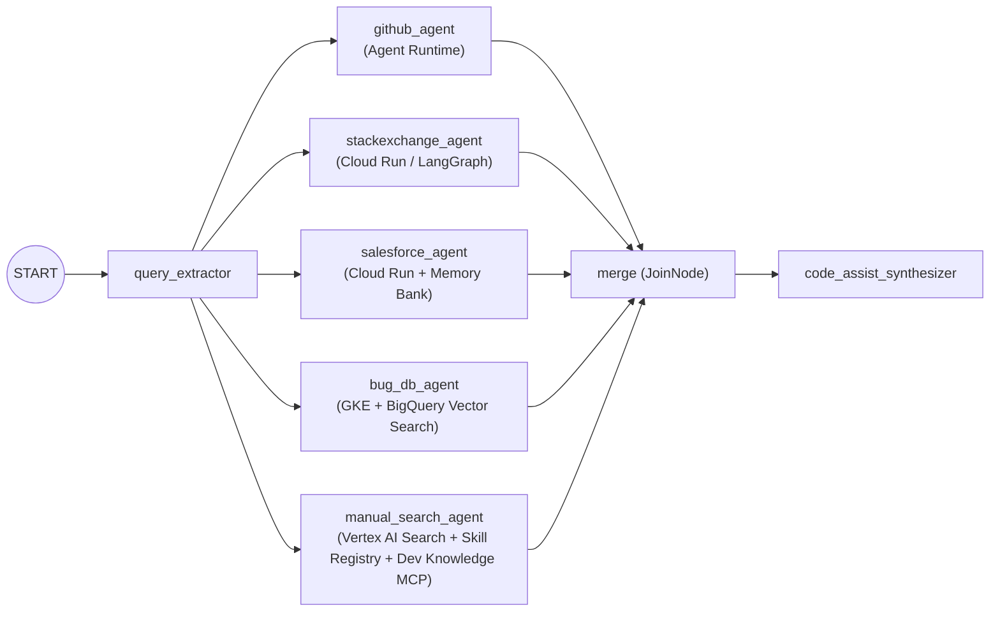

# FDE: Multi-Agent Code Assistant on Google Cloud (ADK 2.0 + A2A)

A distributed, multi-agent engineering incident assistant built with **Google Cloud Agent Development Kit (ADK 2.0)** and the **Agent2Agent (A2A)** protocol.

---

## Documentation Index

| Document | Description |
| :--- | :--- |
| [**Architectural Design (`docs/ARCHITECTURE.md`)**](docs/ARCHITECTURE.md) | End-to-end system architecture, Mermaid topology & sequence diagrams, fan-out/fan-in `JoinNode` design, A2A protocol interoperability (`0.3` vs `1.0`, ADK extension vs. LangGraph), multi-hop authentication, and user-scoped Vertex AI Memory Bank architecture. |
| [**Step-by-Step Lab Manual (`docs/LAB_MANUAL.md`)**](docs/LAB_MANUAL.md) | Complete step-by-step implementation guide covering Tasks 1 through 7 with exact code implementations, environment configurations, and deployment commands. |
| [**Operational Runbook & Playbook (`docs/RUNBOOK_AND_PLAYBOOK.md`)**](docs/RUNBOOK_AND_PLAYBOOK.md) | Day-1/Day-2 operational runbook (pre-flight checks, A2A agent-card smoke tests, unit test suite execution, rolling deployments) and incident response playbooks for common failure modes. |

---

## Repository Structure

```text
.
├── README.md                        # Overview & navigation
├── docs/
│   ├── ARCHITECTURE.md              # System architecture & design patterns
│   ├── LAB_MANUAL.md                # Step-by-step lab manual (Tasks 1-7)
│   └── RUNBOOK_AND_PLAYBOOK.md      # Operational runbook & troubleshooting playbook
├── code-assistant/                  # Root ADK 2.0 Workflow orchestrator (Agent Runtime)
├── github-agent/                    # GitHub MCP specialist agent (Agent Runtime)
├── stackexchange-agent/             # Deterministic LangGraph + a2a-sdk 1.x agent (Cloud Run)
├── bq-agent/                        # BigQuery VECTOR_SEARCH bug specialist (GKE)
└── salesforce-agent/                # Salesforce 2LO + SOSL + Memory Bank specialist (Cloud Run)
```

---

## Architecture Overview


