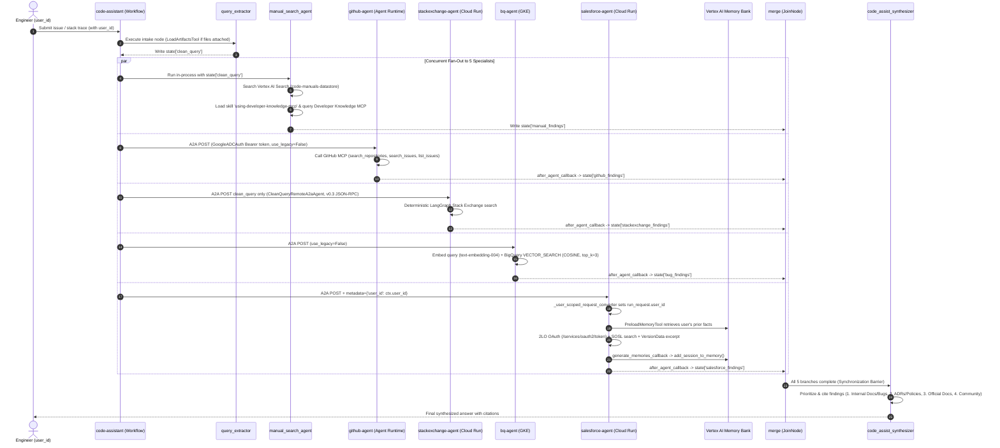

# Architectural Design: Multi-Agent Code Assistant (`FDE`)

## 1. Executive Summary

The **Multi-Agent Code Assistant (`code-assistant`)** is a distributed, production-grade incident triage and engineering assistance platform built on **Google Cloud Agent Development Kit (ADK 2.0)** and the **Agent2Agent (A2A)** protocol.

When an engineer submits a bug report, stack trace, or architectural question (optionally with uploaded logs or screenshots), the root orchestrator extracts a clean search query and fans out **concurrently** across **five specialist agents** spanning **three Google Cloud compute runtimes** (Vertex AI Agent Engine / Agent Runtime, Cloud Run, and Google Kubernetes Engine) and **two agent frameworks** (ADK and LangGraph), before synchronizing via a `JoinNode` barrier and synthesizing a prioritized, cited response.

---

## 2. High-Level System Architecture

```mermaid
flowchart TD
    User["Engineer / Gemini Enterprise User"] -->|"A2A / ADK Web UI (user_id, prompt, artifacts)"| Root["Root Agent: code_assist_agent<br/>(ADK 2.0 Workflow Graph on Vertex AI Agent Runtime)"]

    subgraph RootWorkflow["Root Agent Workflow Graph (code-assistant)"]
        START(("START")) --> QE["query_extractor<br/>(Gemini + LoadArtifactsTool)<br/>output_key='clean_query'"]
        QE -->|"Fan-out (5 Parallel Branches)"| GH["github_agent<br/>(RemoteA2aAgent, use_legacy=False)"]
        QE -->|"Fan-out"| SE["stackexchange_agent<br/>(CleanQueryRemoteA2aAgent, legacy=True)"]
        QE -->|"Fan-out"| SF["salesforce_agent<br/>(RemoteA2aAgent, user_id_meta_provider)"]
        QE -->|"Fan-out"| BQ["bug_db_agent<br/>(RemoteA2aAgent, use_legacy=False)"]
        QE -->|"Fan-out"| MS["manual_search_agent<br/>(In-Process ADK Agent)"]

        GH -->|"github_findings"| Merge["merge<br/>(JoinNode Barrier)"]
        SE -->|"stackexchange_findings"| Merge
        SF -->|"salesforce_findings"| Merge
        BQ -->|"bug_findings"| Merge
        MS -->|"manual_findings"| Merge

        Merge --> Synth["code_assist_synthesizer<br/>(Prioritized, Cited Synthesis)"]
    end

    GH ==>|"A2A + Google ADC OAuth2"| GHEngine["github-agent<br/>(Vertex AI Agent Runtime)"]
    GHEngine -->|"StreamableHTTP MCP + Bearer PAT"| GHMCP["GitHub Copilot MCP Server<br/>(search_repositories, search_issues, list_issues)"]

    SE ==>|"A2A JSON-RPC (v0.3 + v1.0 Dual Card)"| SERun["stackexchange-agent<br/>(LangGraph + a2a-sdk 1.x on Cloud Run)"]
    SERun -->|"REST API"| SEAPI["Stack Exchange API"]

    SF ==>|"A2A + metadata.user_id"| SFRun["salesforce-agent<br/>(ADK on Cloud Run)"]
    SFRun -->|"2LO client_credentials + SOSL"| SFOrg["Salesforce Files REST/SOSL API"]
    SFRun <-->|"PreloadMemoryTool + add_session_to_memory"| MemBank["Vertex AI Memory Bank<br/>(Scoped per user_id)"]

    BQ ==>|"A2A JSON-RPC"| BQGKE["bq-agent<br/>(ADK on GKE Autopilot)"]
    BQGKE -->|"text-embedding-004 + VECTOR_SEARCH"| BQTable["BigQuery: code_assist_bugs.known_bugs"]

    MS -->|"VertexAiSearchTool"| VAIS["Vertex AI Search Datastore<br/>(code-manuals-datastore)"]
    MS -->|"SkillToolset (search_skills / load_skill)"| SkillReg["GCP Skill Registry<br/>(using-developer-knowledge-mcp)"]
    MS -->|"McpToolset"| DevKnow["Google Developer Knowledge MCP<br/>(search_documents, get_documents, answer_query)"]
```



---

## 3. Component & Specialist Matrix

| Component | Agent Name | Framework | Hosting Runtime | Protocol / Integration | Backing Data Source | State Key |
| :--- | :--- | :--- | :--- | :--- | :--- | :--- |
| **Root Orchestrator** | `code_assist_agent` | ADK 2.0 `Workflow` | Vertex AI Agent Runtime | A2A Server + Client | Orchestrates all 5 specialists | N/A |
| **Intake Node** | `query_extractor` | ADK `Agent` | In-process (Root) | `LoadArtifactsTool` | User prompt + uploaded files | `clean_query` |
| **Manual & Docs Specialist** | `manual_search_agent` | ADK `Agent` | In-process (Root) | `VertexAiSearchTool` + `SkillToolset` + `McpToolset` | Vertex AI Search + Skill Registry + Developer Knowledge MCP | `manual_findings` |
| **GitHub Specialist** | `github_agent` | ADK `Agent` | Vertex AI Agent Runtime | A2A (`use_legacy=False`) + `GoogleADCAuth` | GitHub MCP Server (`api.githubcopilot.com/mcp/`) | `github_findings` |
| **Stack Exchange Specialist** | `stackexchange_agent` | LangGraph (`a2a-sdk 1.x`) | Cloud Run | A2A (`CleanQueryRemoteA2aAgent`, `0.3` + `1.0` compat) | Stack Exchange API | `stackexchange_findings` |
| **Bug DB Specialist** | `bug_db_agent` (`bq_agent`) | ADK `Agent` | GKE Cluster (`LoadBalancer`) | A2A (`use_legacy=False`) | BigQuery `VECTOR_SEARCH` (`code_assist_bugs.known_bugs`) | `bug_findings` |
| **Salesforce Specialist** | `salesforce_agent` | ADK `Agent` | Cloud Run | A2A (`use_legacy=False`) + `user_id_meta_provider` | Salesforce Files (SOSL + 2LO OAuth) + Vertex AI Memory Bank | `salesforce_findings` |

---

## 4. End-to-End Request Lifecycle & Sequence Diagram



---

## 5. Key Architectural Design Patterns

### 5.1 Fan-Out / Fan-In Synchronization with `JoinNode`
In ADK 2.0 `Workflow` graphs, connecting one upstream node (`query_extractor`) to a tuple of 5 downstream nodes fans execution out concurrently:
```python
edges=[
    ("START", query_extractor),
    (
        query_extractor,
        (
            github_agent,
            stackexchange_agent,
            salesforce_agent,
            bug_db_agent,
            manual_search_agent,
        ),
    ),
    (
        (
            github_agent,
            stackexchange_agent,
            salesforce_agent,
            bug_db_agent,
            manual_search_agent,
        ),
        merge,
    ),
    (merge, synthesizer),
]
```
Because remote specialists execute over the network with variable latencies, a standard `Agent` node used directly as a fan-in target would trigger once per completing branch. The `merge = JoinNode(name="merge")` acts as a **synchronization barrier** that waits until all five incoming branches have completed and written their findings to session state (`*_findings`) before triggering `code_assist_synthesizer` exactly once.

### 5.2 A2A Protocol Interoperability: ADK Extension vs. Legacy & 1.x Compat
- **ADK-to-ADK (`use_legacy=False`)**: Used by `github_agent`, `salesforce_agent`, and `bug_db_agent`. Enables the ADK A2A executor extension (`https://google.github.io/adk-docs/a2a/a2a-extension/`) which exchanges rich ADK conversation events.
- **ADK-to-LangGraph (`CleanQueryRemoteA2aAgent`, default client)**: `stackexchange-agent` is a deterministic LangGraph agent built with `a2a-sdk 1.x` (no LLM). Two adaptations make this seamless:
  1. **Client-side (`CleanQueryRemoteA2aAgent`)**: Overrides `_construct_message_parts_from_session` to send **only** `session.state["clean_query"]` instead of the full conversation history and raw uploaded file attachments.
  2. **Server-side (`stackexchange-agent/app/server.py`)**: Advertises **both** `1.0` and `0.3` `AgentInterface` entries on `supported_interfaces` and mounts JSON-RPC routes with `enable_v0_3_compat=True` so ADK's `0.3.x` A2A client can parse the `1.x` card and communicate with the server.

### 5.3 Multi-Boundary Authentication Architecture
1. **Root $\rightarrow$ Agent Runtime (`github-agent`)**: Uses `google_authed_client()` backed by `GoogleADCAuth(httpx.Auth)`, which invokes `self._creds.before_request( GoogleAuthRequest(), method, url, headers)` to refresh and attach a Google Cloud OAuth2 Bearer token from Application Default Credentials (ADC).
2. **GitHub Agent $\rightarrow$ GitHub MCP Server**: Uses `StreamableHTTPConnectionParams` with `Authorization: Bearer <GITHUB_PAT>`, `X-MCP-Readonly: true`, and `tool_filter=["search_repositories", "search_issues", "list_issues"]`.
3. **Salesforce Agent $\rightarrow$ Salesforce Org**: Uses **2-Legged OAuth (2LO)** `client_credentials` flow (`POST https://{domain}/services/oauth2/token`), caching the `access_token` and `instance_url` in session state with automatic 401 re-authentication.

### 5.4 Cross-Agent User-Scoped Long-Term Memory
Memory in **Vertex AI Memory Bank** is scoped by `{app_name, user_id}`.
- Without user ID forwarding, an unauthenticated A2A call assigns a transient per-conversation user ID (`A2A_USER_{context_id}`), preventing cross-session recall.
- **Root Side (`code-assistant/app/app_utils/a2a.py`)**: `user_id_meta_provider` attaches `{"user_id": ctx.user_id}` to outgoing A2A request metadata.
- **Specialist Side (`salesforce-agent/app/app_utils/a2a.py`)**: `_user_scoped_request_converter` extracts `request.metadata.get("user_id")` and overrides `run_request.user_id`.
- **Read/Write Cycle (`salesforce-agent/app/agent.py`)**: `PreloadMemoryTool()` preloads relevant user facts before each turn, and `generate_memories_callback` calls `await callback_context.add_session_to_memory()` after each turn.
