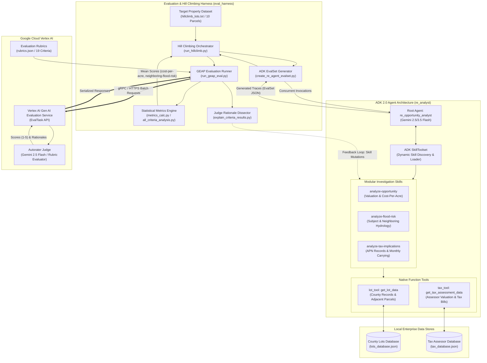
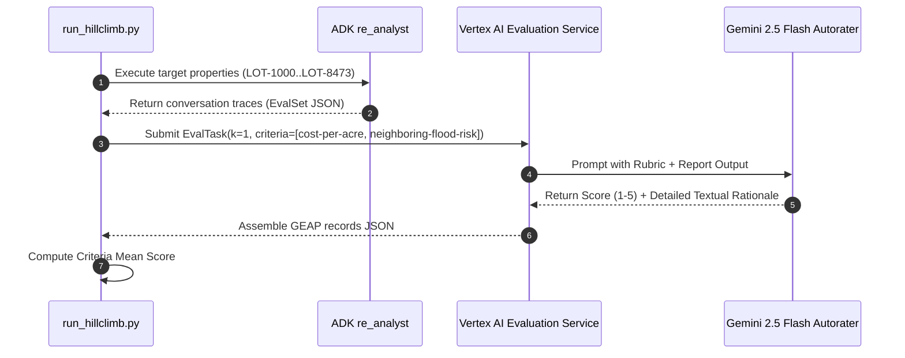
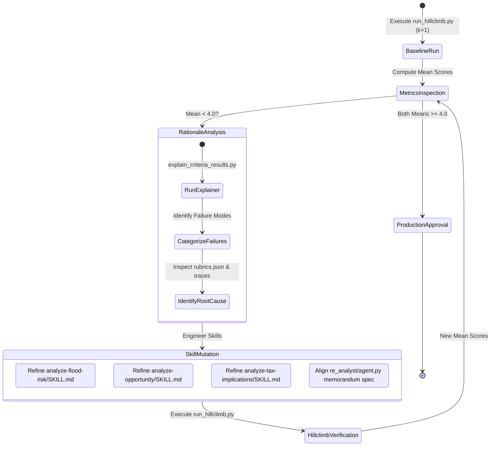

# Architectural Design: Vertex AI GenAI Evaluation Service & ADK Agent Hill Climbing (`Day 3`)

## 1. Executive Summary

In enterprise Generative AI engineering, autonomous agents must be rigorously evaluated and continuously optimized against quantifiable, production-grade quality criteria. Traditional unit testing falls short when assessing nuanced agent outputs such as investment memoranda, clinical summaries, or legal contracts.

**Day 3** establishes the end-to-end architecture for:
1. **LLM-as-a-Judge Evaluation Engine**: Utilizing **Google Cloud Vertex AI Gen AI Evaluation Service** to dispatch multi-pass evaluation runs across 19 custom criteria.
2. **Statistical Reliability & Intra-Rater Agreement Framework**: Quantifying the consistency of LLM evaluators using **Krippendorff's Alpha ($\alpha$)**, **Mean Pairwise Percent Agreement**, and variance distributions across $k$-evaluation passes ($k=12$).
3. **Closed-Loop Hill Climbing Optimization Harness**: Automating single-pass ($k=1$) iteration cycles that execute an **ADK 2.0 (Agent Development Kit)** investment analyst agent (`re_analyst`), evaluate target edge cases, dissect judge rationales, mutate modular skills, and elevate agent performance from baseline failure (scores of `1.4` and `1.1`) to production readiness (`5.0` and `4.6`).

---

## 2. High-Level System Architecture



---

## 3. ADK Agent Architecture (`re_analyst`)

The subject under evaluation is an autonomous Real Estate Investment Opportunity Analyst developed using the **Google Cloud Agent Development Kit (ADK 2.0)**.

### 3.1 Component Hierarchy

```text
re_analyst/
├── agent.py                 # Agent definition, Gemini model client, SkillToolset registration
├── skills/
│   ├── analyze-opportunity/
│   │   └── SKILL.md         # Ingestion, cost-per-acre derivation, executive synthesis
│   ├── analyze-flood-risk/
│   │   └── SKILL.md         # Multi-hop adjacent parcel inspection, hydrological runoff analysis
│   └── analyze-tax-implications/
│       └── SKILL.md         # Assessor valuation reconciliation, monthly carrying cost calculation
└── tools/
    ├── lot_tool.py          # County property lookup (acreage, zoning, flood zone, adjacent parcels)
    └── tax_tool.py          # County tax assessment retrieval (assessed value, official tax liability)
```

### 3.2 Dynamic Skill Discovery and Delegation
ADK decouples tool execution from procedural domain logic through **Skills**. Rather than overloading the model's static system prompt with thousands of specialized rules, skills are loaded dynamically:
1. When prompted (`"Please evaluate investment suitability for lot LOT-8472 and generate a report."`), the agent uses `list_skills` to discover available capabilities.
2. It invokes `load_skill` to inject domain-specific instructions from `SKILL.md` into its working context.
3. The skills guide multi-step investigation:
   - Calling `get_lot_data(plot_id="LOT-8472")` to parse the primary lot schema.
   - Calling `get_tax_assessment_data(parcel_apn="049-382-011-000")` using the APN identified from lot records.
   - Traversing the `adjacent_parcels` list (e.g., `["LOT-8471", "LOT-8473"]`) and calling `get_lot_data` recursively for neighboring properties.

---

## 4. Evaluation Engine & Statistical Formulations

### 4.1 Evaluation Architecture
The evaluation framework executes via **Vertex AI Gen AI Evaluation Service (GEAP)**:
- **Trace Ingestion**: Extracts agent response texts from the ADK `EvalSet` schema.
- **Rubric-Guided Prompting**: Merges agent output with candidate rubrics from `eval_harness/rubrics.json`.
- **Judge Model Execution**: Dispatches evaluation requests to a regional `gemini-2.5-flash` instance with strict scoring constraints.



### 4.2 Mathematical Formulations

#### 1. Criteria Mean Score
For a given criterion across $N$ reports and $k$ evaluation passes:
$$\mu = \frac{1}{N \cdot k} \sum_{i=1}^{N} \sum_{j=1}^{k} S_{i,j}$$

#### 2. Mean Pairwise Percent Agreement
Measures the percentage of identical ratings assigned to the same report across all combinations of judge passes:
$$PA_{pairwise} = \frac{1}{N} \sum_{i=1}^{N} \frac{\sum_{p < q} \mathbb{I}(S_{i,p} == S_{i,q})}{\binom{k}{2}}$$

#### 3. Krippendorff's Alpha ($\alpha$)
Krippendorff's Alpha is a global inter-rater agreement coefficient that generalizes across any number of observers, handles missing data, and adjusts for chance agreement:
$$\alpha = 1 - \frac{D_o}{D_e}$$
Where:
- $D_o$ is the **observed disagreement**:
  $$D_o = \frac{1}{N \cdot k (k - 1)} \sum_{i=1}^{N} \sum_{c=1}^{R} n_{i,c} (k - n_{i,c})$$
  *(with $n_{i,c}$ being the count of judges assigning rating category $c$ to report $i$)*
- $D_e$ is the **expected disagreement by chance**:
  $$D_e = \frac{1}{N k (N k - 1)} \sum_{c=1}^{R} n_c (N k - n_c)$$
  *(with $n_c$ being the total count of times category $c$ was assigned globally)*

#### 4. Agreement Interpretation Matrix

| Metric Range | Krippendorff's $\alpha$ Interpretation | Action in Enterprise Pipeline |
| :--- | :--- | :--- |
| **$\alpha \ge 0.800$** | **High Agreement / Reliable** | Approved for automated production evaluation & gating |
| **$0.667 \le \alpha < 0.800$** | **Moderate Agreement** | Tentative conclusions; requires dual-review or spot-checking |
| **$\alpha < 0.667$** | **Low Agreement / Unreliable** | Reject criterion; refine rubric definitions or scale anchors |

---

## 5. Closed-Loop Hill Climbing Architecture

Hill climbing provides an automated, rapid-feedback loop for targeted agent prompt and skill engineering:



### 5.1 Failure Mode Diagnosis & Skill Mutation Table

| Target Criterion | Baseline Score | Failure Mode Detected by Judge Rationales | Skill Mutation Solution | Post-Optimization Score |
| :--- | :---: | :--- | :--- | :---: |
| **`cost-per-acre`** | `1.4000` | Agent reported last sale price ($450,000) and acreage (1.2 ac) but completely omitted the explicit mathematical division and stated unit cost. | Updated `analyze-opportunity/SKILL.md` and `agent.py` to mandate explicit mathematical derivation: `Price / Acres = $X/acre` and benchmark it as a core valuation metric. | **`5.0000`** |
| **`neighboring-flood-risk`** | `1.1000` | Agent only analyzed the subject parcel's FEMA flood zone; completely ignored adjacent parcels (`adjacent_parcels` list in DB). | Updated `analyze-flood-risk/SKILL.md` to mandate multi-hop `get_lot_data` lookups across all adjacent lots, report their FEMA zones, and critically evaluate runoff/drainage impacts. | **`4.6000`** |
